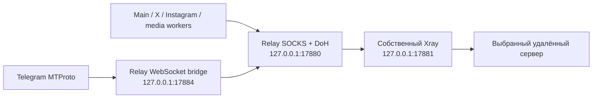

# Egoist Relay 1.2.5 — итоговый аудит

Дата: 29 сентября 2026 года. Исходная установленная версия: **1.2.4**. Проверяется кандидат **1.2.5** для Windows x64.

**Статус: аудит завершён в описанном объёме; личный установщик 1.2.5 подготовлен и проверен локально.** Подтверждены установка, обновление, повторная установка, удаление тестовой копии, native smoke и разрешённое чтение трёх существующих аккаунтов. Проверки не устанавливают круглосуточную доступность или готовность публичного коммерческого выпуска.

Аудит проведён по существующей установке, текущим рабочим исходникам и runtime. Прежние незакоммиченные изменения сохранены. В проекте отсутствует Git remote: актуальность относительно последнего публичного релиза не установлена. Версия 1.2.5 здесь обозначает локальный выпуск проекта.

## 1. Окончательная конфигурация личной сборки

По окончательному решению владельца установщик содержит выбранный private DoH и сохранённый профиль Lagom **VLESS / REALITY / xhttp / stream-up**. Собственный Xray настроен общим backend внешних TCP-путей Relay. Работающий Lagom, его подписка или служба для запуска этой конфигурации не нужны. Профиль не синхронизируется с Lagom автоматически; явный импорт применяется после перезапуска.

DoH-запросы тоже проходят через backend Xray. DNS назначений выполняется только выбранным HTTPS-провайдером, с проверкой сертификата и имени сервера. Для начального определения IPv4 нестандартного DoH используется ограниченный bootstrap Cloudflare, затем Google через тот же backend. Это исключение для имени DNS-провайдера, не запасной DNS для сайтов. Первичное имя самого удалённого Xray-сервера может разрешаться через DNS ОС; полностью исключённый системный DNS для каждого первоначального соединения этим выпуском не заявляется.

При транспортном отказе всех закреплённых IP допускаются одна общая повторная загрузка адресов **того же** DoH-провайдера, не чаще раза в 30 секунд, и один повтор идемпотентного DNS POST. Ошибки DNS-ответа, private/rebinding-адреса, HTTP policy и сертификата не включают другой провайдер или прямую сеть. `ready` означает выбранный провайдер/завершённый bootstrap; отдельное `lastQueryState` описывает последний запрос и не объявляет провайдера недоступным из-за одного NXDOMAIN.

| Свойство | Контракт |
| --- | --- |
| Изоляция | Собственные loopback-порты, процессные handles и Windows Job Object; проверка владельца listener. Чужой процесс не принимается и не завершается |
| Системная сеть | Relay не записывает системные proxy/DNS, firewall, интерфейсы, TUN или маршруты; не устанавливает службу Lagom |
| Выбор пути | Личный профиль закрепляет общий маршрут Main/Telegram/X/Instagram/media; нет автоматического перехода в direct, ciadpi, MTProxy или иной VPN |
| Профиль туннеля | Один loopback SOCKS inbound и один VLESS outbound; строгая проверка REALITY/TLS и xhttp; без `freedom`, обходных маршрутов и дополнительных outbound |
| Runtime | Node **24.21.0**; Xray из официального commit **47cfe999** с Go **1.26.8**, build `47cfe999-relay-go1.26.8`. Путь Xray назначается относительно установленного runtime, не каталога Lagom |
| Приоритет | Собственные сетевые helpers и Node workers получения медиа имеют Windows **BelowNormal CPU priority**. Это не QoS и не приоритет на сервере; интерфейс сохраняет обычный приоритет |
| Хранение после установки | `relay-dns.dpapi` и `relay-tunnel.dpapi`: Windows DPAPI CurrentUser, ACL владельцу и SYSTEM. Оба файла, точное декодирование конфигурации и путь собственного engine подтверждены в установленной тестовой копии |
| Личный дистрибутив | Payload установщика содержит персональные данные подключения, которые можно извлечь. Он предназначен для устройств владельца; защита установленного DPAPI-файла не превращает installer в публичный безопасный пакет |

SHA-256 Xray: `8965A30C44CE8F2DF4CC5AA5DEAC790C767066C31A1FFC218D49923862F3F55C`. Две сборки выбранного commit одним проверенным компилятором дали одинаковые bytes; воспроизводимость на другой машине не проверена. Движок содержит два исправления stream-up Read/Close races, отсутствующие в июльском tag 26.7.28. Более новый 26.9.9/Go 1.27 не принят из-за сообщения upstream о росте stalled TLS sessions в другом режиме stream-one; это не воспроизведённый дефект нашего stream-up. Подробности, лицензии и четыре module-level предупреждения сканера: [аудит Xray](AUDIT-1.2.5-XRAY-ENGINE.md).

В личной копии профиля XMUX использует `maxConnections: 2`, `maxConcurrency: 0`. Это ограничивает активный пул и уменьшает конкуренцию с Lagom: в bounded fixture 128 sessions дали 2 pending TCP вместо 31 с прежним concurrency-пулом. Истечение пула, ограничения HTTP/2 и GOAWAY могут создать дополнительные соединения; жёсткого общего TCP-лимита 2 нет. Возможен меньший burst throughput. Профиль и настройки самого Lagom не меняются.

Обычная сборка без личного туннеля сохраняет отдельную совместимую ciadpi/MTProxy конфигурацию; результаты этого промежуточного режима нельзя переносить на окончательный личный маршрут.

Это изоляция конфигурации и владения процессами приложения. В выборке gateway/bridge не имели внешних TCP-соединений, а backend имел два; полный packet capture и адреса всех дочерних WebView не аудировались. Отсутствие любых обходных UDP/WebRTC или служебных browser connections этим прогоном не доказано; соответствующие сценарии остаются в плане.

## 2. Находки, исправления и границы доказательств

### Сеть и восстановление

| Находка | Исправление | Проверка | Ограничение |
| --- | --- | --- | --- |
| Совместимый listener на общем 1080 принимался за Relay; Telegram мог использовать общую конфигурацию Shield | Собственные порты и проверка TCP owner/managed PID/цепочки потомков/Job Object. Явная ошибочная конфигурация отклоняется | Реальные Windows ownership и parent-death проверки; чужие IPv4/IPv6/wildcard listeners не принимаются | Приложение не изолирует исходящий пакет от системного VPN, firewall или уже установленного WinDivert |
| X/Instagram и workers наследовали общие переменные proxy/опасные Node options; разные части приложения выбирали разные маршруты | Общий выбранный app route, очищенное окружение subprocess, media transport с SOCKS/CONNECT без прямого retry | Синтетические IPC/transport проверки, запрет OS destination DNS и посторонних TCP endpoints; авторизованные ленты X/Instagram загрузились в финальном EXE | Все CDN, типы публикаций и длительная работа не покрыты |
| Один короткий health timeout перезапускал живой helper; Telegram launcher оставлял дочерний listener | Три последовательных отказа для живого процесса, ограниченные задержки запуска 3/6/12/24/30 с; cleanup только собственных проверенных процессов | Воспроизведён orphan listener и проверено освобождение после исправления | Потерянный TCP-сеанс закрывается; установленный поток не переносится и его пакеты не воспроизводятся автоматически |
| Bridge считывал меняющуюся конфигурацию на новом соединении, ошибался при backpressure/heartbeat и бесконтрольно дописывал журнал | Конфигурация фиксируется на срок процесса; framing/heartbeat учитывают давление обеих сторон; ограниченный асинхронный журнал и origins | Byte/order fixtures, фрагментированные пакеты, 4 MiB frames, 16 MiB transfer, потеря upstream и занятой порт | Это локальные fixtures, не многочасовая работа со всеми Telegram DC/CDN |
| Gateway ожидал deadline при раннем FIN до SOCKS CONNECT | Явный отказ при раннем завершении handshake | Исходный сценарий падает, исправленный проходит | Отказ доступа к удалённому серверу остаётся отказом, без перехода в прямую сеть |
| Локальный `dns.lookup` раскрывал путь DNS назначения, ciadpi самостоятельно не обеспечивал выбранный DoH | Валидация DoH URL, TLS/SNI к закреплённому публичному IPv4 через собственный SOCKS; bounded DNS wire parser | Настоящий локальный SOCKS/TLS/HTTPS стенд с запрещённым `dns.lookup`, CNAME compression, ID/question/status, private/mixed answers | IPv4-only; максимум 65 535 bytes тела, 128 запросов, 4096 cache entries, TTL до 600 с |
| Изменение IP custom DoH могло оставлять resolver с непригодными pins до ручного reconnect | Bounded same-provider rebootstrap, coalescing, cooldown 30 с и один DNS retry | Два старых IP заменены двумя новыми; восемь параллельных имён восстанавливаются одной попыткой, cooldown и повтор после него проверены | Это восстановление адреса одного выбранного провайдера; истёкший профиль, его блокировка или отказ сервера этим не исправляются |
| DoH + ciadpi на текущем ПК не обеспечили Telegram TCP | После отдельного решения пользователя личная сборка использует общий выбранный Xray backend | См. живые проверки ниже: исходный TCP-отказ сохранён в отчёте, успешные HTTPS/fault-recovery пробы Xray приведены отдельно | Ни источник потери SYN/SYN-ACK, ни независимость от текущего Lagom/WinDivert не доказаны |

### Медиа, копирование и передача

| Находка | Исправление | Проверка | Ограничение |
| --- | --- | --- | --- |
| Копирование изображения/ссылки/текста документа сообщало успех до записи или при её отказе | Promise/boolean результата, локализованный успех после записи и ошибка при отказе; image copy ограничен 15 с и 32 Mpx | Задержки, отказ clipboard/`execCommand`, decode/encode failures и настоящий вызывающий helper под mock | Реальный OS clipboard не менялся; успешная запись на конкретной версии Windows/WebView не подтверждена |
| Очередь скачиваний теряла добавленную из microtask задачу | Следующий пакет очереди сохраняется; флаг освобождается в `finally`, до 10 запусков в секунду | Воспроизведение `first.png`/потерянного `second.png`; обе задачи проходят после исправления | Anchor click подтверждает запуск запроса, не запись файла |
| Для native download отсутствовало безопасное изолированное подтверждение | Typed `probeDownload(save/cancel)`: fixed 1×1 PNG, версия native gate, точный main/PID/background и launcher-owned profile. SMOKE download пишет только в существующий canonical `profile/downloads`; отсутствие/ссылка отклоняются | Восемь adapter tests; в installed EXE сохранены 70 bytes с точным SHA-256 и terminal event. Отдельная отмена первой операцией в свежем профиле получила canceled event и не создала файл | Последовательность save→cancel в первом профиле не получила terminal event за время проверки; причина не установлена. Отмена проверяет native smoke rejection, не OS save dialog |
| UI/native/Node по-разному распознавали social URL; frontend packet принимал лишние MIME/имена | Общие правила URL, нормализация Instagram `/reels/`, поддержка `/tv/`, отказ неоднозначного YouTube ID, ограниченные MIME/имена/UTF-8 | URL и packet regression matrix | Извлечение stories/live/закрытых публикаций и всех каруселей не обещается |
| `.part` исчезал между сканированием и `lstat`, вызывая ложный timeout; ранняя cancel могла сбрасываться | Только ожидаемый `ENOENT` сканирования пропускается, cancel latch сохраняется; cleanup/лимиты продолжают действовать | Тот же synthetic rename/delete завершает job; ранняя отмена не сбрасывается | Операция может быть отменена при потере helper; продолжение после закрытия приложения не подтверждено |
| Повторный вызов занятого share job выглядел успешно; retry мог создавать лишнюю локальную часть | Явный `SOCIAL_SHARE_BUSY`, сохранение message IDs, пропуск подтверждённых частей | Mock Telegram API/IPC, отмена, retry и повторное использование локального сообщения | Реальная доставка, платные чаты/Stars и повтор после неопределённой отправки через перезапуск не проверены; долговременного журнала job нет |
| Text reader удалял содержимое между `<` и `>` и подтверждал незавершённый clipboard | Для текста сохранено исходное содержимое; DOCX entities/абзацы преобразуются отдельно; feedback зависит от результата | Буквальный текст/XML/Markdown/DOCX fixtures | Это проверка преобразования и feedback, не всех форматов документов |

Передача ограничена до 10 видимых вложений, 64 МиБ на файл и 128 МиБ суммарно; публичный video fallback — до 600 секунд и поддерживаемого формата. Из доступности ссылки не следует полнота извлечённого альбома. Временные файлы, Blob URL, таймауты и отмена проверены синтетически; реальные сообщения и публикации не отправлялись.

### Интерфейс, разрешения и выпуск

| Находка | Исправление | Проверка | Ограничение |
| --- | --- | --- | --- |
| Кнопки titlebar выступали на 0,5 px; resize API rejection оставался необработанным | Высота по доступному контейнеру, локальный catch и cleanup обработчика | 54 варианта оболочки, после исправления ноль измеренных наездов/выходов; injected rejection перехвачен | Не проверены все экраны Telegram и нативный multi-monitor DPI |
| Сокращённые тексты не имели полных tooltip; неактивная ошибка и сетевое ожидание были плохо обозначены | Полный локализованный tooltip/доступное имя, busy/disabled и reduced motion | Клавиатура, callbacks, размеры целей, 125/150/200% browser scale | Headless scale не заменяет Windows DPI, screen reader или наблюдение видимой плавности |
| DNS initialization error при живых helpers выглядел как готовность, DNS отсутствовал в доступном имени | `dns:unavailable` учитывается в статусе; DNS-строка входит в tooltip/aria-label; `ready` описывает выбранного провайдера | 16 геометрических сочетаний, 8 комбинаций статусов, 3 browser scales и 8 component tests | Локальная готовность не заявляет доступность аккаунта или конкретного DNS-ответа |
| `npm test` ссылался на отсутствующий setup и не запускал проверки | Рабочая конфигурация тестов и отдельный TypeScript test project | Полные central gates ниже | Test count не измеряет полноту покрытия приложения |
| Неиспользуемые installer/updater IPC расширяли доступ renderer; native CSP была выключена | Лишние команды убраны; native CSP повторяет уже существовавшую политику Vite; updater по умолчанию отключён | Native/TS/build gates | Полноценный независимый pentest не проводился; подписанный update channel отсутствует |
| Runtime и зависимости требовали обновления | Node 24.21.0 и совместимые исправления зависимостей; интерфейсный стек и существующие библиотеки сохранены | Повторные central tests и production build | Это не заявление о последней публичной версии всех компонентов или отсутствии будущих уязвимостей |
| NSIS helpers под Windows PowerShell 5.1 ломались на UTF-8/BOM, замене файла и наследованном PSModulePath от PowerShell 7; последний дефект воспроизведён как отсутствие Set-Acl | Стабильная передача UTF-8 bytes, корректный null для File.Replace, ASCII diagnostic text в process guard; три helper используют встроенные модули из PSHOME | Минимальный NSIS reproducer и реальное обновление 1.2.4→1.2.5 с последующими DPAPI/ACL checks и repair/uninstall | Production installer на пользовательскую установку не запускался; проверена копия с изолированной регистрацией |
| Launcher контрольного API оставлял пустые optional port variables вместо удаления, вызывая строгий отказ native bootstrap | В adapter launch-control.ps1 переменные удаляются через Remove-Item Env: | После штатного завершения неудачного запуска та же версия EXE загрузила все три существующих аккаунта | Это исправление диагностического adapter; в installer он не включён |

## 3. Результаты проверок

Два прежних `react/no-danger` предупреждения DocumentReader проверены отдельно. Markdown сначала экранирует исходный HTML, затем разрешает только http/https/mailto ссылки с экранированием атрибутов. DOCX использует textContent и собственную генерацию фиксированных тегов; raw Mammoth HTML и relationships не вставляются. В 11 Markdown attack/safe-link fixtures и одном synthetic DOCX не получены активные теги, обработчики событий или опасные href. Это проверка данных двух путей, не доказательство отсутствия XSS во всём приложении.

### Общие проверки итоговых исходников

| Проверка | Подтверждённый результат |
| --- | --- |
| Frontend/Vitest | **172/172**, без пропусков |
| Node | **119/119**, без пропусков; после последней смены значения XMUX отдельно **9/9** тестов builder. Числа пересекаются и не складываются |
| Native/Cargo | **56/56** |
| Adapter native download | **8/8**, без пропусков; реальный installed-app gate учитывается отдельно |
| Xray engine gates | **23/23**: TLS/XHTTP, конфигурации и bounded stalls |
| TypeScript и ESLint | **0 ошибок**, 2 прежних предупреждения |
| CSS/Stylelint | **0 ошибок**, 510 предупреждений; полный CSS без предупреждений не заявляется |
| Production native build | EXE 1.2.5, 93 195 264 bytes; SHA-256 `745B86EF8EC93E24ED79132FDF3AE21A84EEB36BB69D4110439EF82502F4B544`. Тот же payload установлен и проверен. Есть linker informational warning и NSIS warning 6010 |

Числа относятся к централизованному прогону. [MEDIA](AUDIT-1.2.5-MEDIA.md) содержит исторические scoped 44 frontend/19 Node и прежний native 17; [UI](AUDIT-1.2.5-UI.md) — геометрию оболочки и component tests; [NETWORK](AUDIT-1.2.5-NETWORK.md) — собственные 84 gateway/bridge fixtures и промежуточные native gates. Они пересекаются с общим прогоном и **не суммируются**. Формулировки ciadpi/«опциональный tunnel» в сетевом отчёте описывают прежний этап; окончательный личный маршрут определён разделом 1 этого документа.

### Живые сетевые пробы на этом ПК

| Маршрут и метод | Результат | Что установлено |
| --- | --- | --- |
| Выбранный DoH → ciadpi, три стратегии и дополнительные numeric/WSS-host пробы | **39 probes: 36 Telegram failures, 3 control HTTPS successes** | Telegram TCP на этой сети не заработал от DNS/TCP-desync. Numeric DC наблюдался в `SynSent` до TLS; изменение TLS splitting не является подтверждённым исправлением |
| Общий выбранный Xray, четыре HTTPS-пробы | **4/4 HTTP 200** | Выбранный удалённый маршрут обеспечил доступ к этим четырём HTTPS-адресам в этой выборке |
| Отдельная fault/recovery проба Xray | Во время отказа код проверки **97**, после восстановления **HTTP 200** | Зафиксирован отказ и последующее восстановление выбранного маршрута; это не длительный soak |

HTTP 200 сам по себе не подтверждает авторизацию и полноту медиа. Авторизованные интерфейсы проверены отдельно ниже. Точный источник отказа ciadpi не установлен. На ПК установлены Lagom/WinDivert; аудит не менял их настройки ради сравнительной чистоты. Состояние всех сторонних процессов не фиксировалось непрерывно. Промежуточные доказательства: [network connectivity](AUDIT-1.2.5-NETWORK-CONNECTIVITY.json) и [network fixtures](AUDIT-1.2.5-NETWORK-EVIDENCE.json).

### Финальный EXE: native и существующие аккаунты

В installed EXE первоначальный smoke дал **29 успешных пунктов и один неопределённый результат** terminal event отмены. Повторные switch/snapshot observations входят в число 29; это не 29 независимых функций. PNG сохранён с completed event: 70 bytes, SHA-256 `882ee7678d2018081ac8852ce4c2f9eb2ec9780c18bc91246b323eeea3d4a231`. Первая отмена после сохранения не создала файл, но terminal event не пришёл; этого недостаточно для успешного cancellation gate. Отдельная отмена первой операцией в свежем собственном профиле прошла: `settled=true`, `downloadEventReceived=true`, `status=canceled`, файл отсутствует. Влияние browser multiple-download policy — гипотеза, не установленная причина. История неопределённого результата сохранена.

Native window reuse, reject-external и close-restore прошли с сохранением bound target, метаданных, профиля и восстановлением title. Bundled speech: синтетическая русская речь совпала с нормализованной reference; тишина, некорректный input и отмена получили ожидаемые terminal codes. Это не тест распознавания реальных аккаунтных записей.

После подтверждённого пользователем выхода старого Relay через трей тот же финальный EXE запущен с существующим профилем. Визуально подтверждены **авторизованный список чатов Telegram**, **лента X с отображёнными медиа**, **лента Instagram с изображениями**. «Избранное» открылось с двумя media markers и видимыми изображениями. Native picker пересылки из X и Instagram открылся и закрылся безопасной кнопкой отмены. Получатели не выбирались, отправка/публикация/загрузка в аккаунт не выполнялись. Отображённый video frame не является доказательством воспроизведения. Свежесть каждого элемента ленты и полнота всех CDN отдельно не измерялись. Приватные snapshots и screenshots не включены в релиз.

Все три запущенных аудитом экземпляра завершены через штатный bound API с `exited=true`; собственные listeners освобождены. Read-only pilot показал ноль изменений clipboard sequence и foreground PID, отличный от тестового приложения. Курсор менялся во время параллельной активности пользователя; источник не атрибутирован, неизменность курсора не заявляется.

### Принудительные отказы и короткая стабильность

Последовательно остановлены только собственные backend, gateway и Telegram bridge. Родительский EXE сохранил PID, выбранный маршрут остался tunnel, сторонние listeners не принимались.

| Собственный компонент | Локальный listener восстановлен | Подтверждён HTTPS 200 после отказа |
| --- | --- | --- |
| Xray backend | 5,164 с | 11,480 с |
| SOCKS/DoH gateway | 8,880 с | 15,289 с |
| Telegram bridge | 8,380 с | 14,416 с |

Эти интервалы включают polling/запуск probes; это наблюдённые времена конкретного прогона, не гарантированный SLA. Начальная проверка harness ошибочно приравняла локальный listener к WAN readiness и получила отказ; после исправления harness отдельно измеряет оба состояния. Из-за отказа gateway/backend текущий запрос действительно прерывался; бесшовного сохранения существующих TCP-сессий нет.

После восстановления выполнен soak с целью 360 секунд: фактически **385,9 с, 20 samples, 10 HTTPS-запросов**, без неожиданных смен PID трёх helpers и без ошибок probes в этой выборке. Node/Xray/bridge имели BelowNormal CPU priority. Совокупный private commit собственного дерева процессов с тремя WebView составил **1264,7–1282,1 МиБ**. Это не RSS, не объём памяти только native EXE и не доказательство отсутствия суточной утечки. Небольшой XMUX уменьшил число соединений в bounded fixture, общего ускорения программы не измерено.

## 4. Установщик и закрытые локальные проверки

Артефакт: **Egoist Relay_1.2.5_x64-personal-setup.exe**, **604 771 373 bytes**. SHA-256: `47B46EBD7F366EBC426C7C43A58396BCBB552622833518E6473EDA13E7B380BE`. [Установщик и инструкция](../release/1.2.5/README.md).

| Gate | Статус и требуемое доказательство |
| --- | --- |
| Финальный Xray | **ПРОЙДЕН:** официальный commit 47cfe999/Go 1.26.8, SHA-256 закреплён, 23 engine gates, 4/4 HTTPS на личном маршруте, source/provenance и 51 dependency license/notice включены |
| Личный installer | **ПРОЙДЕН В ИЗОЛИРОВАННОЙ КОПИИ:** exact EXE и 96 runtime files; обновление старого payload 1.2.4→1.2.5, repair/reinstall и uninstall; оба DPAPI roundtrip/ACL, engine внутри install и отсутствие plaintext enrollment. Регистрация, protocol и профиль копии отличались от пользовательских |
| Работающий экземпляр при установке | **ПРОЙДЕН:** installer отказал с exit 2, сохранил PID и payload работающей своей копии; process guard не завершал её принудительно |
| WebView2 | **PAYLOAD ПОДТВЕРЖДЁН:** встроен offline Microsoft installer 212 213 456 bytes, Authenticode Valid. 1.3.271.7 — stamp wrapper, не версия Chromium. На этом ПК runtime уже установлен; ветка чистой VM без WebView2 не прогонялась |
| Native download | **СОХРАНЕНИЕ И ОТДЕЛЬНАЯ ОТМЕНА ПОДТВЕРЖДЕНЫ:** file/hash/event; отмена первой операцией свежего профиля без файла. Первоначальный save→cancel остаётся неопределённым |
| Built-app fault/soak | **ПРОЙДЕН В ВЫБОРКЕ:** три собственных helper faults, recovery и короткий soak; штатное завершение без оставшихся listeners |
| Реальные аккаунты | **ПРОЙДЕН ОГРАНИЧЕННЫЙ READ-ONLY:** три авторизованных интерфейса, Saved Messages media и два share preview/cancel. Delivery, login на другом ПК и полный media matrix не проверены |
| Системное состояние | **11/11 НЕИЗМЕННЫ:** шесть registry scopes, системный DNS, persistent routes, WinHTTP proxy, состояние/режим/путь служб Lagom/Shield и hash исходного EXE. Пользовательская установка осталась 1.2.4 |
| Итоговое evidence | [manifest](../release/1.2.5/release-manifest.json), [installer evidence](../release/1.2.5/installer-verification.json), [native evidence](../release/1.2.5/native-verification.json), [soak](../release/1.2.5/native-network-soak.json), [account evidence](../release/1.2.5/account-verification.json), [host comparison](../release/1.2.5/host-verification.json) |

Системная сверка выполнена одной версией Windows PowerShell 5.1 и сравнивает canonical поля. Первоначальные расхождения hashes, вызванные порядком JSON properties и PS5/PS7 сериализацией CIM, проверены по исходным значениям и не считаются изменением настроек. Fingerprint не фиксирует весь трафик, временные DNS caches или каждый сторонний процесс. Тестовый uninstall удалил свой payload и регистрацию; свои DPAPI-профили сохранил. Пользовательский installer на исходную установку в ходе аудита не запускался.

Probe native download принимает только фиксированные `save/cancel`, не paths/URLs/code и не запись clipboard. Реальная отправка и системный буфер обмена не являются частью этих разрешённых release probes и остаются непроверенными.

## 5. Ограничения для публичного/коммерческого выпуска

1. **Windows code signing отсутствует.** Публичное доверие к издателю и отсутствие SmartScreen-предупреждений не подтверждены.
2. **Подписанного канала обновлений нет.** Auto-updater отключён; обновление — новый installer после штатного выхода через трей. Автоматический безопасный rollout/rollback не доказан.
3. **Нет независимой матрицы 24×7, нескольких сетей и fresh VM.** Сон/пробуждение, смена Wi-Fi, разные VPN/firewall, second PC без Lagom и native monitor DPI требуют отдельного прогона. Собственная конфигурация Relay не исключает влияние underlay Lagom/WinDivert/Windows VPN.
4. **Реальный OS clipboard и отправка не проверены.** Mock success не доказывает физическую запись; сообщения, посты, загрузка в аккаунт и Stars не выполнялись. Неопределённая отправка после перезапуска требует проверки истории.
5. **Telegram dynamic DC/CDN покрыты не полностью.** Начальная официальная TCP-матрица не заменяет передачу актуальных `dc_options` и CDN endpoints из клиента. Большие аккаунтные загрузки, региональные изменения, IPv6-only, UDP, звонки и WebRTC media требуют отдельной реализации/проверки.
6. **Внешние ограничения сохраняются.** Истечение private DNS/VLESS профиля, лимиты сервера/сессий, блокировка IP, CAPTCHA, доступность X/Instagram/YouTube и изменения HTML/API не контролируются Relay. Ни профиль, ни сервер не переключаются автоматически для обхода отказа.
7. **Личный installer непригоден для общего распространения.** Его ключи извлекаемы; для публичного продукта нужны отдельный provisioning, отзыв/обновление профилей и проверенный механизм доставки секретов.
8. **Нет доказанного общего ускорения или идеальной плавности.** Bounded buffers, CPU priority и отсутствие геометрических дефектов в выборке не устанавливают производительность всей программы. Скрытый WebView и короткие frame samples не подтверждают видимую плавность.
9. **Остаются проверки безопасности и распространения.** npm production audit не сообщил advisories, но три moderate dev advisories остаются. Xray source scanner дал четыре module warnings без affected package/symbol traces; stripped binary fallback не доказывает активный уязвимый путь. GPL corresponding source/offer для всех включённых компонентов, включая FFmpeg, полностью не проверены. Независимый pentest не проведён.

## 6. Последующий план

Локальные проверки личного выпуска закрыты в указанном объёме. Следующие обязательные этапы перед публичным выпуском: чистая VM и второй ПК без Lagom, 24–72 часа работы со сном/сменой сети и разными VPN/firewall, dynamic Telegram DC/CDN и большие медиа. Далее — Windows signing, подписанный update channel, provisioning без личных ключей и проверка лицензий/source offers. Реальную запись clipboard и доставку проверять отдельным сценарием с согласованным содержимым и получателем. Критерии и приоритеты: [план](PLAN-1.2.5.md).

Выполненные изменения устраняют воспроизведённые дефекты и согласуют выбранный маршрут приложения. Данных для утверждений «всегда работает», «без конфликтов с любым VPN» или «полностью готов конкурировать на рынке» пока нет.

Связанные материалы: [план](PLAN-1.2.5.md), [media](AUDIT-1.2.5-MEDIA.md), [UI](AUDIT-1.2.5-UI.md), [network](AUDIT-1.2.5-NETWORK.md), [release notes](RELEASE-1.2.5.md).
