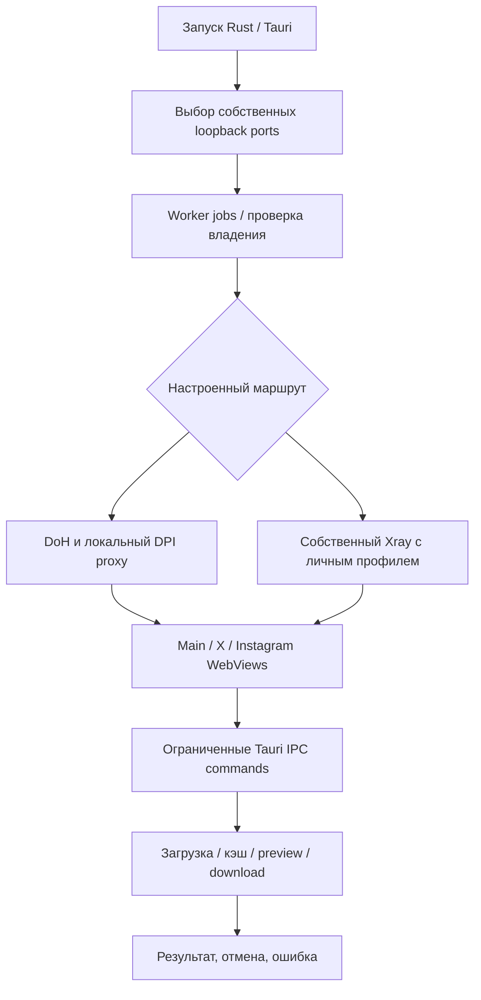

# Egoist Relay — план доводки до публичного выпуска

Дата: 30 сентября 2026. План относится к продукту и проверкам, а не к обещанию «100% без ошибок». Выполнение одного этапа не отменяет критерии следующих.

## Назначение и границы продукта

Relay объединяет Telegram, X и Instagram в Windows-приложении. Основной сценарий: открыть сервис, найти сообщение или материал, просмотреть, сохранить либо подготовить пересылку. Пользователь должен понимать, что загружается, почему операция не прошла и какое действие доступно дальше. Работа сети относится только к Relay; системные DNS, proxy, routes и службы Lagom остаются под управлением владельца компьютера.

Личный пакет содержит профиль владельца. Публичный пакет должен предоставлять понятный выбор независимого подключения; нельзя молча выдавать чужой персональный endpoint или обещать, что один DNS снимает любые ограничения.

## Архитектура, которую следует сохранять

Доступность процесса, работоспособность DNS и доступность внешнего сервиса — разные состояния. Восстановление ограничено собственными процессами; established TCP stream не переигрывается. Главный WebView не должен незаметно переходить на прямое подключение при отказе туннеля. Секреты не попадают в renderer, сообщения об ошибках и публичные логи. Bootstrap hostname туннеля через системный DNS остаётся явно описанным ограничением текущей реализации.

## Этапы и критерии завершения

**Первый незакрытый сценарий после финальной упаковки:** YouTube через выбранный личный tunnel возвращает `MEDIA_BOT_CHECK`; тот же public sample на generic маршруте играет. Нужно проверить официальную страницу/плеер на том же маршруте, выделенный тестовый аккаунт и легитимную пользовательскую проверку, затем обычное видео и Shorts. Результат должен включать фактические playing/pause/stop и устойчивость повторного открытия. Не менять маршрут молча и не переносить личный профиль владельца другим пользователям. До воспроизводимого успеха этот сценарий остаётся открытым, даже при ready всех локальных помощников.

| Этап | Работа | Проверяемый результат |
| --- | --- | --- |
| 1. Текущий кандидат | Исправления IPC, media lifetime/cancel, DNS/IP failover, port ownership, WebView bounds, sticker geometry, Reader, installer guard и оболочки. | Версии согласованы; проверки исходников проходят; точный payload устанавливается, запускается и штатно завершается. Протокол хранит и неудачные первые попытки. |
| 2. Воспроизводимый пакет | Найти exact source/build inputs FFmpeg, ciadpi и egoist-tg-proxy; доставить нужные dependency sources и notices. Если происхождение не восстанавливается — заменить компонент собственным воспроизводимым build. | Чистый checkout + задокументированный toolchain дают проверенный функциональный пакет; corresponding-source gate закрыт по каждому распространяемому компоненту. Пока это не выполнено, публичная публикация заблокирована. |
| 3. Другое устройство | Windows 10 build 18362 / актуальная Windows 11, обычная учётная запись, Unicode path, без Node/Rust/Lagom/WebView2; offline WebView2 install; свежая установка, обновление, reinstall, uninstall. | Приложение разворачивается только из пакета; личный профиль зашифрован для нового Windows-пользователя; generic не содержит личных ключей. Минимальные OS/runtime проверены фактически. |
| 4. Пользовательские функции | Матрица Telegram login/search/media/stickers/Reader; X/Instagram auth/navigation/share picker; копирование изображения, save/cancel, forward/upload, deep links и переключение сервисов. Отправку проверять на специально выделенных тестовых аккаунтах после явной авторизации. | Для каждого сценария сохранены входные условия, наблюдаемый результат и восстановление после отказа. Подготовка picker не считается доказательством отправки; queued download click не считается доказательством файла на диске. |
| 5. Сеть и длительность | 24–72 часа, sleep/resume, смена Wi‑Fi, потеря WAN, отказ DoH/endpoint, занятые ports, bind race, работа поверх нескольких реально используемых VPN. Проверять только собственный профиль/помощников. | Нет изменений системных DNS/proxy/routes; нет adoption/kill чужих процессов; повторные попытки ограничены и не создают restart storm; память/CPU и worker count не растут монотонно при повторяемой нагрузке. Любое восстановление и downtime измерены. |
| 6. Полный дизайн | Применить систему из DESIGN-1.3.0.md к настройкам, сетевому onboarding, медиа, документам и picker; проверить keyboard/screen reader, контраст, длинный русский текст, DPI и reduced motion. | Нет clipping/overlap в согласованной матрице; все действия имеют состояния и доступные названия; данные и ошибки читаются без знания реализации. Сторонние X/Instagram страницы оцениваются отдельно от контролируемой оболочки Relay. |
| 7. Поддержка выпуска | Локальные диагностические коды без account content; инструкция обновления/отката, privacy/licensing notices, reproducible CI artifact, поддерживаемая площадка публикации. Подпись — отдельное решение владельца. | Можно воспроизвести дефект по обезличенному отчёту, найти версию/runtime/route и восстановить работоспособность. Публичный release собирается утверждённым workflow из проверенных inputs. |

## Дизайн основных сценариев

- **Первый запуск:** понятные названия сервисов, локальная готовность и объяснение настройки маршрута. Не предлагать глобальное изменение DNS/VPN как побочный шаг установки.
- **Загрузка:** placeholder сохраняет геометрию; видны ожидание, прогресс, отмена и завершение. Retry доступен после понятного отказа, а не бесконечно работает в фоне.
- **Ошибка:** человеческая причина и следующее действие; технический код помещается в диагностику. Авторский запрет, ограничение доступа и сетевой отказ различаются.
- **Документы:** текст, поиск, zoom и download читаемы при узкой ширине и увеличенном шрифте; фокус возвращается в исходное действие после закрытия.
- **Сеть:** отдельно показаны отказ настройки, локальная готовность и реальная проверка внешнего сервиса. Не показывать «всё работает» на основании одного живого PID.
- **Обновление:** закрыть Relay штатно; проверить пакет; сохранить аккаунтные профили; запретить случайный downgrade; объяснить отказ вместо тихого частичного успеха.

## Что считать готовностью

Готовность к личному тестированию: проверены текущие исходники и конкретный unsigned пакет на текущем host, персональные данные защищены и ограничения описаны.

Готовность к публичному выпуску: завершены этапы происхождения компонентов, чистого устройства, пользовательской матрицы и длительной сети; критические дефекты устранены; оставшиеся ограничения опубликованы. Подпись может оставаться отсутствующей по принятому решению, но это не следует выдавать за подписанный продукт.

Требования «никогда не отключается», «идеален на любом устройстве» и «100% изучено» не имеют подтверждённого конечного теста. Для релиза нужны измеримые сценарии, допустимые пределы и воспроизводимая диагностика.
