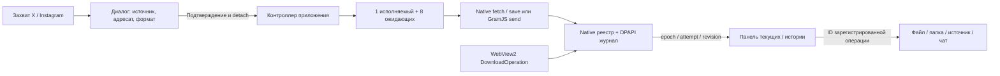

# Владение медиа-операциями

## Состояния и восстановление

Queued → Resolving → Downloading / Preparing → Writing / Sending → Completed. Ошибки завершают попытку как Failed, Cancelled, Interrupted или Uncertain. Данные до подтверждения принадлежат диалогу; принятый capture принадлежит контроллеру. `finally` освобождает Blob URL и native-контекст. Отмена действует на оставшиеся шаги, worker и COM; подтверждённые сообщения не отзываются.

Native сохраняет переходы и подтверждения атомарно, частый прогресс держит в памяти. Получатель, random IDs и fingerprints фиксируются до send. При неизвестном исходе после crash/send failure автоматический повтор запрещён. Ручной repeat требует текущего аккаунта и нового полного захвата.

## Хранение и IPC

Журнал: `<service-data>/media-operations/journal-v1.dpapi`. Header ERMO/v1, DPAPI CurrentUser с UI_FORBIDDEN, protected owner/SYSTEM DACL. До 30 дней и 500 terminal entries; прочитанный размер ограничен 4 MiB plaintext. Старый повреждённый файл не стирается и не подменяется пустой историей. В журнале нет cookies, токенов, временных CDN URL, media bytes и текста переписки. Метаданные source/name/path/mime/size/dimensions и recipient/confirmed/IDs/fingerprints остаются локальными.

Новые команды перечислены в `tauri/build.rs`, main-only capability и дополнительно проверяют label/origin. Список/события скрыты при блокировке. Файл открывается по ID+index зарегистрированного результата; renderer не передаёт произвольный путь. Источник проверен и канонизирован, неизвестный source не придумывается.

## Файлы, PAC и deadlines

Собственный UUID-каталог и `.part`, create-new, проверка, sync_all, атомарный MoveFileW без замены. Коллизия получает новое имя. Аварийное восстановление убирает только принадлежащие приложению stage-файлы с проверенным ownership. Единый дедлайн попытки сохранения — 900 с включает PAC, fallback и копирование. Пересылка ограничена 64 МиБ на файл, 128 МиБ на набор и 10 медиа; внутренний максимум 16 сообщений учитывает части текста.

Асинхронный WinHTTP resolver закрывается при отмене/deadline. Callback/context живёт до HANDLE_CLOSING; порядок proxy/bypass и запрет скрытого DIRECT после ошибки PAC сохраняются.

## UI и native geometry

Панель 24rem уменьшает сервис только при оставшихся 40rem. В полном режиме рабочая область содержит панель, WebView скрыт без уничтожения. Native геометрия обновляется отдельной командой по измеренному viewport; покадровой анимации границ нет. Содержимое появляется за 140 мс, reduced motion убирает движение. RU/EN, логические RTL-свойства, клавиатурные tabs/Escape/CtrlJ.
